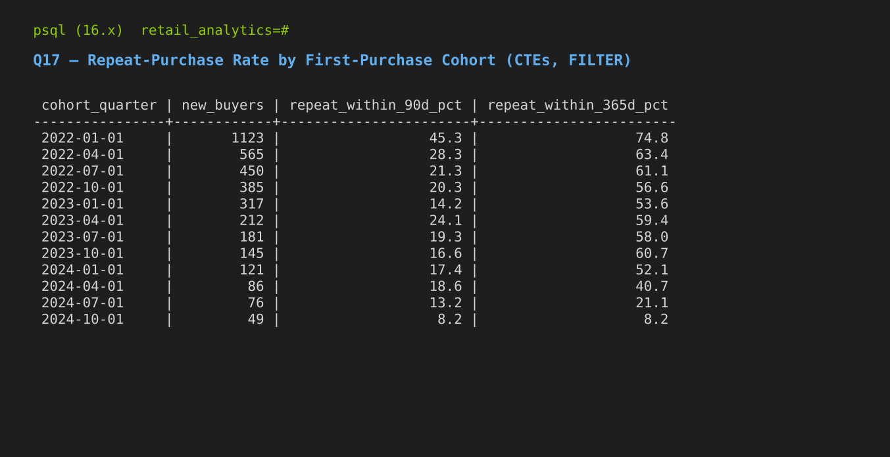

# Retail Analytics SQL Project

An end-to-end PostgreSQL analytics project: a messy raw dataset, a documented
cleaning pipeline, a normalized relational schema, 30 business queries
(joins, window functions, CTEs), and a written set of
[findings and recommendations](#findings), all executed and verified
against a live PostgreSQL 16 database.

**Headline results:** the top 10% of customers generate 41.7% of revenue
and almost never lapse; deeper discounts cut gross margin from 48.7% to 38.6%
with no larger baskets; and 1,531 delivered or shipped orders have no
completed payment.

## A note on the data, upfront

I don't have access to a paid data-licensing pipeline, so rather than pass
off a downloaded CSV as more than it is, I built a **synthetic but
referentially-correct e-commerce dataset** using Python (Faker), sized and
shaped to resemble a real mid-size online retailer:

- **64,699 order line items** across **21,933 orders**, **4,000 customers**,
  **250 products**, and **12 categories** (after cleaning)
- 3 years of order history (2022–2024) for meaningful trend/cohort analysis
- Skewed customer behavior (15% of customers drive ~50% of orders) instead
  of uniform randomness, so retention/cohort/top-customer queries return
  realistic, non-trivial results
- **Intentional data quality problems** injected into the raw data
  duplicate rows, inconsistent casing, blank fields, sign errors, orphaned
  foreign keys, out-of-range values, so the cleaning script in this repo
  solves a real problem instead of a decorative one

Designing the schema and generating valid relational data at this scale is
itself a real, demonstrable skill and every query below was run against
the actual resulting database, not written speculatively.

Because the data is synthetic, the findings below describe this dataset,
not a real market. The point is the method: asking business questions,
checking whether a difference is real, and turning numbers into actions.

## Findings

Revenue throughout = net of line discounts, excluding cancelled orders.
Every figure comes from a query in [`sql/04_findings.sql`](sql/04_findings.sql)
(F1–F8) or [`sql/03_business_queries.sql`](sql/03_business_queries.sql).

| # | Finding | Evidence |
|---|---|---|
| 1 | **Growth has stalled.** Revenue was €26.2M (2022), €27.4M (2023) and €27.0M (2024): +4.6%, then −1.4%. Order value (~€4,000) and gross margin (~46%) barely moved. | F1 |
| 2 | **Revenue depends on a small group.** The top 10% of buyers (371 customers) generate **41.7%** of revenue; the top 20% generate 63.0%. | F2 |
| 3 | **Most customers lapse, but the best ones don't.** 53.5% of buyers have not ordered in the last 180 days. In the top 10% by spend, only **1.6%** have lapsed, versus 59.3% of everyone else. | F3 |
| 4 | **Discounts cost margin without bigger baskets.** Lines with an 11–20% discount earned a 38.6% gross margin, against 48.7% without a discount, yet units per line were the same (3.54 vs. 3.51). | F4 |
| 5 | **Three categories drag on margin.** Automotive (38.3%), Beauty & Personal Care (40.6%) and Electronics (42.3%) have the lowest gross margins; Books (50.9%) and Office Supplies (49.6%, the largest category at 14.4% of revenue) the highest. | F5, Q29 |
| 6 | **Payments don't reconcile.** 1,138 completed and 393 shipped orders have no completed payment, and 823 orders were underpaid by a combined **€897,656**. | F6, Q26 |
| 7 | **New-buyer numbers are falling.** First-time buyers per quarter dropped from 317 (2023-Q1) to 49 (2024-Q4); 290 registered customers never bought anything. | Q17, DQ2 |
| 8 | **Some apparent differences are just noise.** Payment failure rates range from 4.25% (debit card) to 5.35% (PayPal), but a chi-square test finds no significant difference across methods (χ² = 7.64, df = 4, p = 0.11). Region and segment differences in order value are within ±2.5% of the overall average. | F7, F8 |

Caveats: findings 3 and 7 are measured against the last date in the data
(2024-12-31). Finding 4 is an association, not proof that discounts cause
lower margins on their own, because discounts were not randomly assigned.
The customer list in finding 7 is a fixed pool of 4,000, which partly
explains why first-time buyers decline over time.

### Recommendations

1. **Protect the top 10%.** With 41.7% of revenue in 371 accounts, give
   them named account management and track their recency weekly; losing a
   handful of them would show up in total revenue.
2. **Test a win-back campaign on lapsed customers, with a holdout group.**
   1,979 of the lapsed buyers sit outside the top decile. A randomised
   holdout shows whether the campaign actually brings people back rather
   than just counting those who would have returned anyway.
3. **Run a controlled test of the 11–20% discount tier.** It is linked to
   ten points less margin with no larger baskets. Pausing it for a random
   half of customers would show whether it drives any sales at all.
4. **Send the reconciliation list to finance.** The 1,531 delivered or
   shipped orders without a completed payment and the 823 underpaid orders
   (F6) should be checked one by one before any further analysis.
5. **Don't change payment methods based on failure rates.** The differences
   are not statistically significant.
6. **Fix the signup date at the source.** See data-quality issue DQ1 below.

### Data-quality issue found during analysis

**DQ1:** 8,947 orders (40.8%) are dated *before* the customer's
`signup_date`, which is impossible. It's not clear which date is wrong, so no
rows were dropped. Instead, cohort analysis (Q17) groups customers by **first
purchase** rather than signup date. In a real company this would be raised
with the owners of the source system.

Retention by first-purchase cohort (Q17):



## Folder structure

```
retail-analytics-sql/
├── README.md
├── data/
│   └── raw/                     # messy CSVs "as received from source systems"
│       ├── categories_raw.csv
│       ├── customers_raw.csv
│       ├── products_raw.csv
│       ├── orders_raw.csv
│       ├── order_items_raw.csv
│       ├── payments_raw.csv
│       └── reviews_raw.csv
├── sql/
│   ├── 00_staging_schema.sql    # loose/TEXT landing tables for raw data
│   ├── 01_schema.sql            # final clean schema (constraints, indexes)
│   ├── 02_data_cleaning.sql     # staging -> clean, fully commented
│   ├── 03_business_queries.sql  # the 30 queries
│   └── 04_findings.sql          # queries behind every number in Findings
├── scripts/
│   ├── generate_data.py         # synthetic data generator (Faker-based)
│   ├── import_raw_data.sh       # one-command setup: schema + load + clean
│   └── render_screenshots.py    # renders real query output to PNG
├── diagrams/
│   ├── er_diagram.dot
│   └── er_diagram.png
└── screenshots/
    ├── q01.png                  # top products by revenue
    ├── q03.png                  # MoM revenue growth (LAG window function)
    └── q27.png                  # 2nd-best seller per category (DENSE_RANK)
```

## Schema


Seven tables: `categories`, `customers`, `products`, `orders`, `order_items`,
`payments`, `reviews`. `order_items` is the central fact table joining
orders to products; `reviews` link back to a specific `order_item`, not
just a product, so a review always ties to an actual purchase.

## Setup

Requires PostgreSQL 16+ and Python 3.

```bash
# 1. Generate the raw dataset (or use the CSVs already in data/raw/)
cd scripts && python3 generate_data.py

# 2. Create a database
createdb retail_analytics

# 3. Run the full pipeline: staging schema -> clean schema -> load -> clean
./import_raw_data.sh retail_analytics
```

This builds the staging tables, loads the raw CSVs, and runs the cleaning
script that produces the final constrained tables — all in one command.

```bash
# 4. Run the analysis
psql -d retail_analytics -f sql/03_business_queries.sql
psql -d retail_analytics -f sql/04_findings.sql
```

## Data cleaning: what was actually wrong, and how it was fixed

| Issue | Where | Fix |
|---|---|---|
| Duplicate rows (~1–2%) | every table | `ROW_NUMBER() OVER (PARTITION BY id ORDER BY ctid)`, keep first |
| Inconsistent casing | `email`, `order_status` | `LOWER(TRIM(...))` |
| Empty-string "nulls" | `email`, `city`, `order_date` | `NULLIF(TRIM(x), '')` |
| Sign errors (negative price/qty) | `products`, `order_items` | `ABS()` — a documented assumption, not a silent fix |
| Missing required fields | `orders.order_date` | rows dropped (no safe default exists) |
| Out-of-range values | `reviews.rating` outside 1–5 | rows dropped as unrecoverable |
| Orphaned foreign keys | `order_items`, `payments`, `reviews` | filtered via `NOT EXISTS` / `EXISTS` checks |

Full detail with inline reasoning for every decision is in
[`sql/02_data_cleaning.sql`](sql/02_data_cleaning.sql).

## Sample query output (real, captured from the live database)

**Q1 — Top 10 best-selling products by revenue** (`INNER JOIN`, `GROUP BY`)


**Q3 — Month-over-month revenue growth %** (`CTE`, `LAG()` window function)


**Q27 — Second-best-selling product per category** (`DENSE_RANK()`, a classic interview question)


## The 30 queries

All in [`sql/03_business_queries.sql`](sql/03_business_queries.sql), grouped by theme:

**Revenue & Sales (Q1–Q10):** top products, monthly revenue, MoM growth
(`LAG`), running total (`SUM() OVER`), 3-month rolling average, revenue by
region, category revenue share, average order value by segment, declining
products quarter-over-quarter, profit margin tiers (`CASE WHEN`)

**Customer Analytics (Q11–Q20):** top customers by spend (`RANK`), customers
with zero orders (`LEFT JOIN`), full outer join diagnostic, products never
ordered (`RIGHT JOIN`), `ROW_NUMBER`/`RANK`/`DENSE_RANK` side-by-side, new
vs. returning customers, first-purchase cohort repeat rates, churn flagging,
time-to-second-purchase (`LEAD` + `ROW_NUMBER`), customers above average
order value (CTE + subquery)

**Operations & Quality (Q21–Q30):** order status breakdown, return rate by
category, unreviewed bestsellers, average rating per product (`HAVING`),
payment failure rate, payment/order reconciliation discrepancies, 2nd-best
seller per category (`DENSE_RANK`), days since last order, gross margin by
category with cumulative profit share, and a full multi-CTE executive
summary combining most of the above techniques in one query

### Revision notes (October 2026)

A review of the queries found and fixed these logic errors:

- **Q1, Q7, Q27** counted cancelled orders, which hold 8.4% of line value,
  while other queries excluded them. Revenue is now defined the same way
  everywhere.
- **Q10** labelled markup (profit ÷ cost) as margin (profit ÷ price). That
  put 84 of 250 products in the wrong tier. It now shows both, tiered by margin.
- **Q17** used signup-date cohorts, which DQ1 makes unreliable. It now uses
  first-purchase cohorts and reports retention as a percentage.
- **Q19** returned every pair of consecutive orders (16,414 rows) instead of
  only first-to-second (3,058 rows).
- **Q20** averaged order *lines* (€1,361) instead of *orders* (€4,008), and
  its benchmark included cancelled orders.
- **Q22** counted order lines while labelling them orders.
- **Q29** summed catalogue cost prices as "inventory value", but the schema has
  no stock levels. It now reports realised gross margin by category.

## Techniques demonstrated

`INNER JOIN` · `LEFT JOIN` · `RIGHT JOIN` · `FULL JOIN` · `GROUP BY` ·
`HAVING` · `CASE WHEN` · CTEs · Window functions (`ROW_NUMBER`, `RANK`,
`DENSE_RANK`, `LAG`, `LEAD`) · Running totals · Rolling averages · Date
functions (`DATE_TRUNC`, date arithmetic) · Subqueries (scalar and
correlated) · `FILTER (WHERE ...)` aggregates

## Tech stack

PostgreSQL 16 · Python 3 (Faker, for data generation) · Graphviz (ER diagram)
