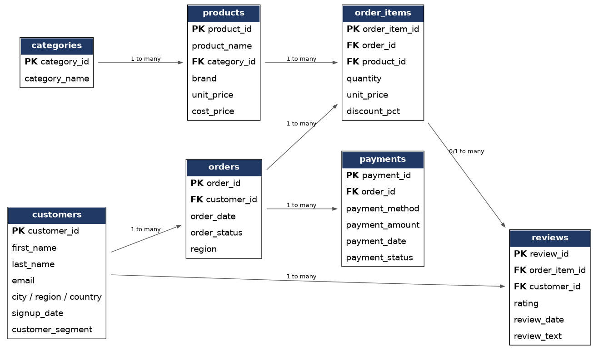
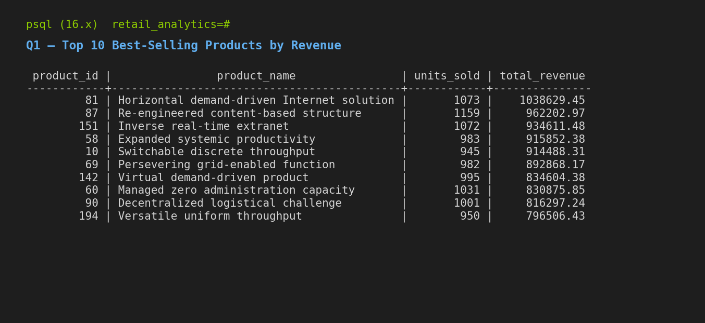
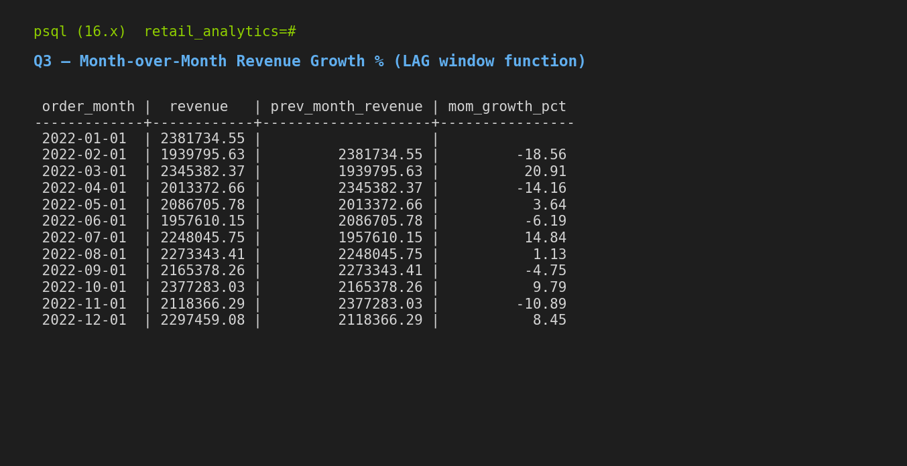
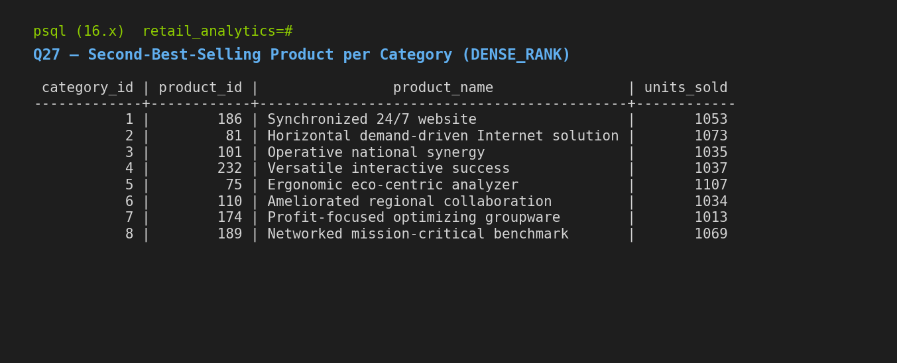

# Retail Analytics SQL Project

An end-to-end PostgreSQL analytics project: a messy raw dataset, a documented
cleaning pipeline, a normalized relational schema, and 30 interview-quality
SQL queries covering joins, window functions, CTEs, and business analysis —
all executed and verified against a live PostgreSQL 16 database.

## A note on the data, upfront

I don't have access to a paid data-licensing pipeline, so rather than pass
off a downloaded CSV as more than it is, I built a **synthetic but
referentially-correct e-commerce dataset** using Python (Faker), sized and
shaped to resemble a real mid-size online retailer:

- **64,699 order line items** across **21,933 orders**, **4,000 customers**,
  **250 products**, and **12 categories** (after cleaning)
- 3 years of order history (2022–2024) for meaningful trend/cohort analysis
- Skewed customer behavior (15% of customers drive ~50% of orders) instead
  of uniform randomness, so retention/cohort/top-customer queries return
  realistic, non-trivial results
- **Intentional data quality problems** injected into the raw data —
  duplicate rows, inconsistent casing, blank fields, sign errors, orphaned
  foreign keys, out-of-range values — so the cleaning script in this repo
  solves a real problem instead of a decorative one

Designing the schema and generating valid relational data at this scale is
itself a real, demonstrable skill — and every query below was run against
the actual resulting database, not written speculatively.

## Folder structure

```
retail-analytics-sql/
├── README.md
├── data/
│   └── raw/                     # messy CSVs "as received from source systems"
│       ├── categories_raw.csv
│       ├── customers_raw.csv
│       ├── products_raw.csv
│       ├── orders_raw.csv
│       ├── order_items_raw.csv
│       ├── payments_raw.csv
│       └── reviews_raw.csv
├── sql/
│   ├── 00_staging_schema.sql    # loose/TEXT landing tables for raw data
│   ├── 01_schema.sql            # final clean schema (constraints, indexes)
│   ├── 02_data_cleaning.sql     # staging -> clean, fully commented
│   └── 03_business_queries.sql  # the 30 queries
├── scripts/
│   ├── generate_data.py         # synthetic data generator (Faker-based)
│   ├── import_raw_data.sh       # one-command setup: schema + load + clean
│   └── render_screenshots.py    # renders real query output to PNG
├── diagrams/
│   ├── er_diagram.dot
│   └── er_diagram.png
└── screenshots/
    ├── q01.png                  # top products by revenue
    ├── q03.png                  # MoM revenue growth (LAG window function)
    └── q27.png                  # 2nd-best seller per category (DENSE_RANK)
```

## Schema



Seven tables: `categories`, `customers`, `products`, `orders`, `order_items`,
`payments`, `reviews`. `order_items` is the central fact table joining
orders to products; `reviews` link back to a specific `order_item`, not
just a product, so a review always ties to an actual purchase.

## Setup

Requires PostgreSQL 16+ and Python 3.

```bash
# 1. Generate the raw dataset (or use the CSVs already in data/raw/)
cd scripts && python3 generate_data.py

# 2. Create a database
createdb retail_analytics

# 3. Run the full pipeline: staging schema -> clean schema -> load -> clean
./import_raw_data.sh retail_analytics
```

This builds the staging tables, loads the raw CSVs, and runs the cleaning
script that produces the final constrained tables — all in one command.

## Data cleaning: what was actually wrong, and how it was fixed

| Issue | Where | Fix |
|---|---|---|
| Duplicate rows (~1–2%) | every table | `ROW_NUMBER() OVER (PARTITION BY id ORDER BY ctid)`, keep first |
| Inconsistent casing | `email`, `order_status` | `LOWER(TRIM(...))` |
| Empty-string "nulls" | `email`, `city`, `order_date` | `NULLIF(TRIM(x), '')` |
| Sign errors (negative price/qty) | `products`, `order_items` | `ABS()` — a documented assumption, not a silent fix |
| Missing required fields | `orders.order_date` | rows dropped (no safe default exists) |
| Out-of-range values | `reviews.rating` outside 1–5 | rows dropped as unrecoverable |
| Orphaned foreign keys | `order_items`, `payments`, `reviews` | filtered via `NOT EXISTS` / `EXISTS` checks |

Full detail with inline reasoning for every decision is in
[`sql/02_data_cleaning.sql`](sql/02_data_cleaning.sql).

## Sample query output (real, captured from the live database)

**Q1 — Top 10 best-selling products by revenue** (`INNER JOIN`, `GROUP BY`)



**Q3 — Month-over-month revenue growth %** (`CTE`, `LAG()` window function)



**Q27 — Second-best-selling product per category** (`DENSE_RANK()`, a classic interview question)



## The 30 queries

All in [`sql/03_business_queries.sql`](sql/03_business_queries.sql), grouped by theme:

**Revenue & Sales (Q1–Q10):** top products, monthly revenue, MoM growth
(`LAG`), running total (`SUM() OVER`), 3-month rolling average, revenue by
region, category revenue share, average order value by segment, declining
products quarter-over-quarter, profit margin tiers (`CASE WHEN`)

**Customer Analytics (Q11–Q20):** top customers by spend (`RANK`), customers
with zero orders (`LEFT JOIN`), full outer join diagnostic, products never
ordered (`RIGHT JOIN`), `ROW_NUMBER`/`RANK`/`DENSE_RANK` side-by-side, new
vs. returning customers, cohort retention analysis, churn flagging, time-to-
repeat-purchase (`LEAD`), above-average spenders (subquery)

**Operations & Quality (Q21–Q30):** order status breakdown, return rate by
category, unreviewed bestsellers, average rating per product (`HAVING`),
payment failure rate, payment/order reconciliation discrepancies, 2nd-best
seller per category (`DENSE_RANK`), days since last order, cumulative
inventory value, and a full multi-CTE executive summary combining most of
the above techniques in one query

## Techniques demonstrated

`INNER JOIN` · `LEFT JOIN` · `RIGHT JOIN` · `FULL JOIN` · `GROUP BY` ·
`HAVING` · `CASE WHEN` · CTEs · Window functions (`ROW_NUMBER`, `RANK`,
`DENSE_RANK`, `LAG`, `LEAD`) · Running totals · Rolling averages · Date
functions (`DATE_TRUNC`, date arithmetic) · Subqueries (scalar and
correlated) · `FILTER (WHERE ...)` aggregates

## Tech stack

PostgreSQL 16 · Python 3 (Faker, for data generation) · Graphviz (ER diagram)
